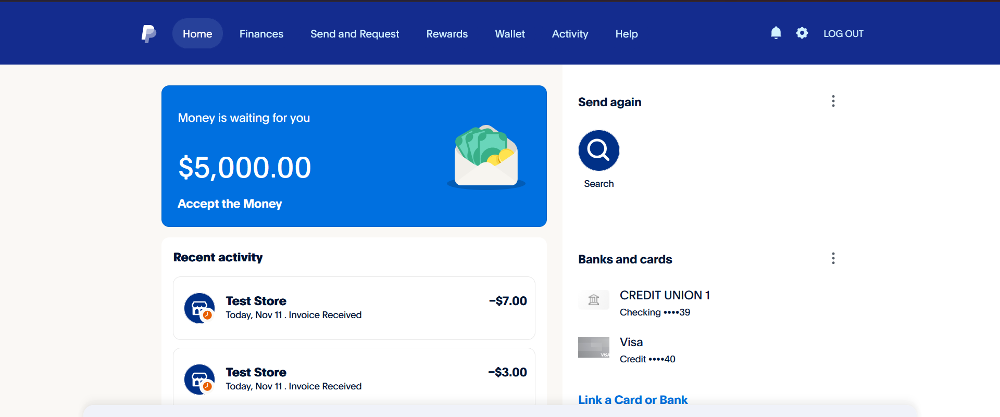
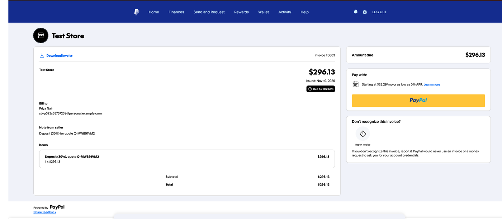
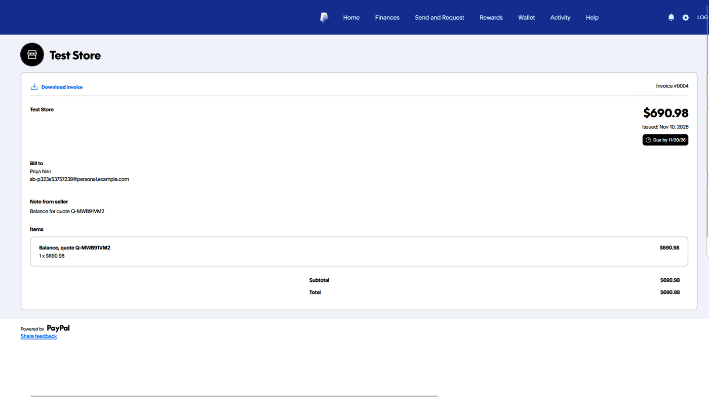
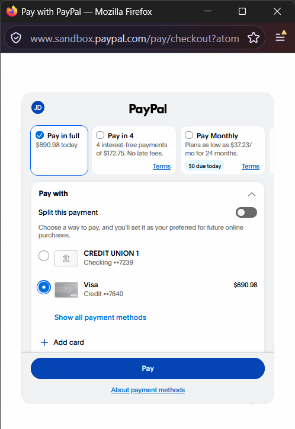
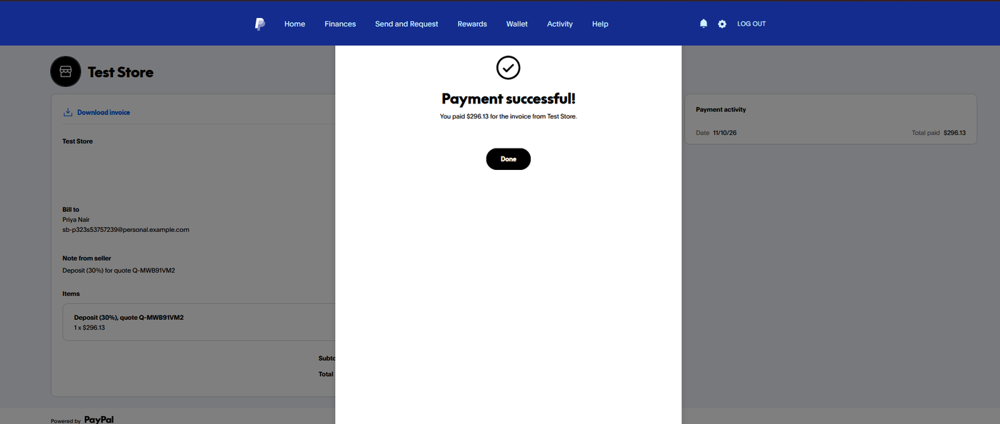
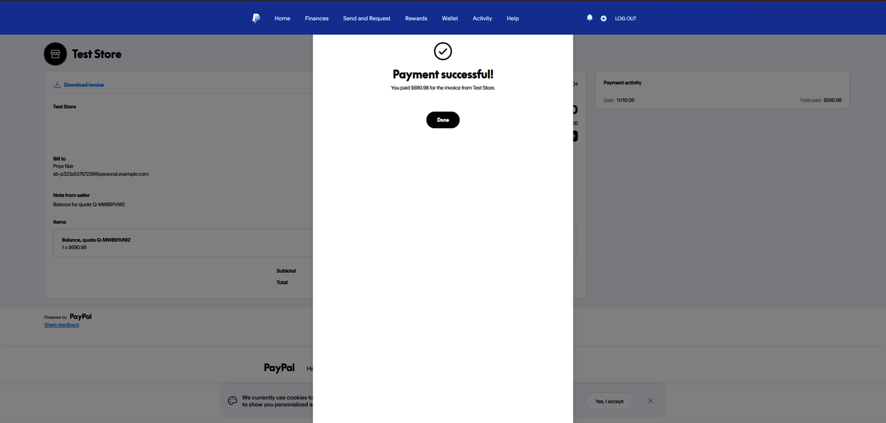
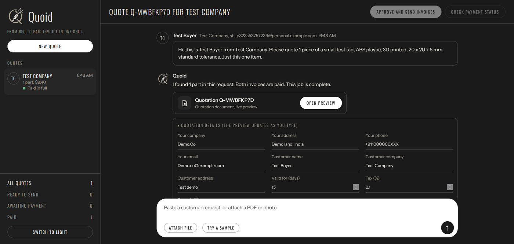

# Payment flow in action

This page shows the payment part of Quoid working end to end in the PayPal sandbox. The screenshots come from real test runs. All money is fake sandbox money.

**The quote used in steps 1 to 5:** Q-MWB91VM2, a 3-part quote for Nova Robotics.

| Invoice | Amount |
|---|---|
| Deposit (30% in this run) | $296.13 |
| Balance | $690.98 |
| **Quote total** | **$987.11** |

## Step 1. Approve and send the invoices

In Quoid, put the customer's PayPal email in **Bill to** and click **Approve and send invoices**. Quoid creates two invoices through the PayPal Invoicing API, a deposit and the balance, and sends both to the customer. The deposit percentage is not fixed: it is 30% by default and can be changed in **Quotation details** before approving (this run used 30%). The quote status becomes **Awaiting deposit**.

## Step 2. The customer receives the invoices

The deposit invoice (#0003) arrives for **$296.13**, with the note "Deposit (30%) for quote Q-MWB91VM2".

The balance invoice (#0004) arrives for **$690.98**, with the note "Balance for quote Q-MWB91VM2". Both are due ten days after they are issued.

## Step 3. The customer pays

The customer clicks the **PayPal** button on the invoice. PayPal opens its checkout window, here for the balance of **$690.98** paid in full with a card. The customer clicks **Pay**.

## Step 4. PayPal confirms the payment

PayPal shows "Payment successful!" and the **Payment activity** panel shows the total paid.

Deposit, **$296.13**:

Balance, **$690.98**:

## Step 5. Quoid updates the quote

Back in Quoid, click `CHECK PAYMENT STATUS`. Quoid asks PayPal about each unpaid invoice, marks the paid ones, and updates the quote:

- Only one invoice paid: the status is **Part paid**.
- Deposit paid, balance still open: the status is **Deposit paid**.
- Both paid: the status is **Paid in full**, and the quote moves to the **Paid** filter.

The screenshot below is from a separate small test quote (Test Company, $9.40), paid in the same way.

When the app is deployed with the PayPal webhook set up, PayPal tells Quoid about each payment, so the status can update without clicking. The button stays available as a manual check.

## What this proves

- Invoices are created and sent through the PayPal Invoicing API, with the right amounts and notes.
- The customer pays on PayPal's own pages, so Quoid never handles card details.
- Quoid reads the payment back from PayPal, and does not rely on anything typed in by hand.
